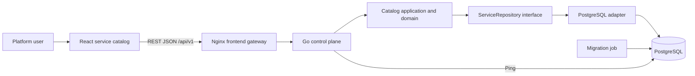

# LaunchRail Architecture

## Current system

LaunchRail is a modular monolith with a React client and PostgreSQL persistence. The control plane is one Go deployable with domain, application, transport, and infrastructure boundaries. This keeps the first production-style vertical slice reviewable while leaving external integrations behind narrow interfaces.

## Backend boundaries

- **Domain:** service identity, mutable metadata, lifecycle validation, timestamps, and archive rules. It does not depend on HTTP or PostgreSQL.
- **Application:** Register, Get, List, Update, and Archive use cases. It coordinates the domain, repository interface, and injected clock.
- **Transport:** versioned HTTP routes, JSON decoding, request limits, DTO mapping, and safe error responses.
- **Infrastructure:** PostgreSQL repository, migration runner, configuration, structured logging, and graceful HTTP server lifecycle.

The API process does not apply migrations. A separate migration command owns schema transitions, and Compose enforces migration completion before API startup.

## Request and failure flow

1. Nginx serves the single-page application and proxies `/api` without enabling broad cross-origin access.
2. HTTP middleware accepts or generates an `X-Request-ID`, then records structured request completion logs.
3. Handlers enforce JSON media type, a 1 MiB request limit, strict fields, path IDs, and list query bounds.
4. The application service invokes domain behavior and persists through `ServiceRepository`.
5. Known domain and repository errors become stable client error codes. Unknown errors are logged with the request ID and returned as a generic `500` response.

## Data model

The `services` table stores UUID identity, an immutable unique service key, mutable catalog metadata, lifecycle, audit timestamps, and a nullable archive timestamp. Database constraints mirror important domain invariants. Archived records remain queryable and cannot be edited.

## Planned architecture

The following are not part of the current implementation:

- Identity provider integration and role-based access control.
- GitHub repository discovery and metadata synchronization.
- Kubernetes workload and environment inventory.
- GitOps delivery with Argo CD and progressive delivery with Argo Rollouts.
- OpenTelemetry collection and Prometheus, Grafana, Tempo, and Loki backends.
- AWS and Terraform delivery layers.

These capabilities should extend the modular control plane until an independently scalable or isolated deployment boundary is demonstrated.
