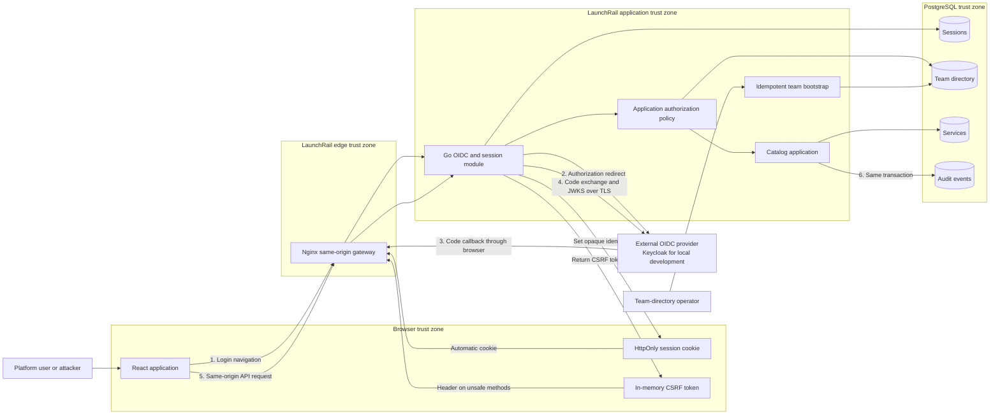

# Identity and authorization threat model

- Status: Design baseline; controls are planned, not implemented
- Date: 2026-07-17
- Scope version: Service catalog through commit `fea6092`, plus the identity design in ADR 0003 and ADR 0004
- Review trigger: Any authentication, authorization, session, team, audit, reverse-proxy, or identity-provider change

## Purpose and status

This document models the authentication and team-authorization boundary planned for LaunchRail. It is a design input for the identity milestone, not evidence that the controls exist. The current service catalog remains unauthenticated until the implementation, tests, OpenAPI contract, and deployment configuration are completed.

The method uses data-flow decomposition and STRIDE categories to identify threats at entry points and trust boundaries, following the [OWASP Threat Modeling Process](https://owasp.org/www-community/Threat_Modeling_Process).

## Scope

### Included

- Browser sign-in and logout through a generic OIDC provider.
- The same-origin Nginx gateway and Go backend-for-frontend.
- OIDC authorization transactions, callbacks, claim validation, and JWKS use.
- PostgreSQL-backed sessions, controlled teams, service records, and audit events.
- Authentication and authorization of the existing service catalog API.
- Operator provisioning of team-to-OIDC-group mappings.
- Local Keycloak as a future Compose reference implementation.

### Excluded

- GitHub discovery, webhooks, and repository credentials.
- Kubernetes, GitOps, deployment orchestration, and cluster credentials.
- Cloud infrastructure, Terraform, and production secret-manager selection.
- Observability backends and a remote immutable audit sink.
- Security of the identity provider's own implementation and administrator console.

The model must be extended before any excluded integration is implemented.

## Security objectives

1. Only a successfully authenticated OIDC identity can access service metadata.
2. Only a member of the owning team or a platform administrator can mutate a service.
3. Only a platform administrator can transfer service ownership.
4. Browser scripts never receive provider tokens or the session identifier.
5. Cross-origin sites cannot perform authenticated state changes.
6. Every successful catalog mutation is attributable and atomically audited.
7. Authentication and authorization failures deny access without exposing secrets or internal provider errors.

## Assets

| Asset                                                     | Required property                                                  |
| --------------------------------------------------------- | ------------------------------------------------------------------ |
| OIDC client secret                                        | Confidentiality and controlled rotation                            |
| Authorization code, PKCE verifier, state, and nonce       | Confidentiality, integrity, single use, and short lifetime         |
| Session identifier and CSRF token                         | Confidentiality, unpredictability, binding, expiry, and revocation |
| Issuer, subject, administrator decision, and group claims | Integrity and provenance                                           |
| Team directory and external-group mappings                | Integrity and administrative control                               |
| Service metadata and ownership                            | Integrity, availability, and authenticated confidentiality         |
| Audit events and request IDs                              | Integrity, append-only retention, and actor attribution            |
| OIDC configuration and trusted public origin              | Integrity and operator control                                     |

## Actors and trust assumptions

| Actor                            | Trust level and capability                                                             |
| -------------------------------- | -------------------------------------------------------------------------------------- |
| Anonymous visitor                | Untrusted; can reach public health and authentication entry points.                    |
| Authenticated reader             | Can read catalog data but has no implicit mutation rights.                             |
| Team member                      | Can mutate services owned by a mapped team they belong to.                             |
| Platform administrator           | Can manage every service and transfer ownership; compromise has broad impact.          |
| Malicious or compromised browser | Can issue arbitrary requests and may execute injected script in the LaunchRail origin. |
| OIDC provider                    | External trusted identity authority; compromise is residual systemic risk.             |
| Team-directory operator          | Privileged operator trusted to provision exact group mappings.                         |
| Database operator                | Privileged infrastructure actor able to bypass application-level controls.             |

Production is assumed to terminate TLS at a trusted reverse proxy, keep the API and PostgreSQL off untrusted networks, and obtain the OIDC client secret outside source control. Local HTTP is an explicit loopback-only exception and is not representative of production security.

## Planned data-flow diagram

The following diagram describes the planned identity architecture. The existing implementation contains only the browser, Nginx, Go API, service catalog, migrations, and PostgreSQL portions.

## Data flows and controls

| Flow                        | Data crossing a boundary                                    | Required controls                                                                             |
| --------------------------- | ----------------------------------------------------------- | --------------------------------------------------------------------------------------------- |
| Login initiation            | `returnTo`, state, nonce, PKCE challenge                    | Same-origin path validation, cryptographic randomness, transaction expiry, one-time use       |
| OIDC callback               | Code, state, issuer context                                 | Exact callback, state and nonce binding, PKCE S256, issuer/audience/signature/time validation |
| Session creation and lookup | Opaque identifier, normalized identity, membership snapshot | Identifier hashing, rotation, idle and absolute expiry, revocation, generic failures          |
| Authenticated read          | Session cookie, request ID                                  | Same-origin proxy, authenticated session, safe structured logging                             |
| Catalog mutation            | Cookie, CSRF token, Origin, actor, service and team         | CSRF token, exact Origin, application-layer policy, controlled team resolution                |
| Audit write                 | Actor, action, target, before/after metadata                | Same database transaction, append-only runtime privilege, secret filtering                    |
| Logout                      | Session, CSRF token                                         | Unsafe method, Origin and CSRF checks, server-side revocation, cookie clearing                |
| Team bootstrap              | Team slug, display name, exact OIDC group                   | Explicit operator action, idempotence, validation, change audit, no public UI                 |

## Security requirements

- **SR-01:** The issuer and public origin come only from validated deployment configuration.
- **SR-02:** Authorization transactions use PKCE S256, state, and nonce and expire within ten minutes.
- **SR-03:** ID tokens are accepted only after signature, issuer, audience, expiry, issued-at, and nonce validation.
- **SR-04:** Session identifiers have at least 256 bits of entropy, are stored only as hashes, rotate after login, and have 30-minute idle and eight-hour absolute expiry.
- **SR-05:** Production cookies use `Secure`, `HttpOnly`, `SameSite=Lax`, `Path=/`, no `Domain`, and the `__Host-` prefix.
- **SR-06:** Unsafe authenticated methods require a session-bound CSRF token and an exact trusted Origin.
- **SR-07:** Authorization derives from server-side identity and resource state, never from client-supplied roles or permissions.
- **SR-08:** OIDC group matching is exact; team slugs resolve through the controlled directory.
- **SR-09:** Ownership transfer requires `platform-admin` even when the caller belongs to both teams.
- **SR-10:** Successful mutations and audit events commit or roll back together.
- **SR-11:** Secrets, tokens, raw cookies, authorization codes, and raw request bodies are excluded from logs and audit events.
- **SR-12:** Authentication endpoints have request-size limits, timeouts, bounded caches, and rate limits.
- **SR-13:** Failure of PostgreSQL, provider validation, JWKS retrieval outside a bounded valid cache, or audit persistence fails closed.
- **SR-14:** The runtime database role cannot update or delete audit events and cannot apply schema migrations.
- **SR-15:** The insecure-cookie development exception is rejected unless the external host is loopback.

## Risk assessment

Likelihood and impact use a three-point scale: 1 low, 2 medium, and 3 high. Risk is likelihood multiplied by impact: 1-2 low, 3-4 medium, and 6-9 high. Controls marked planned must be implemented and tested before authentication can be described as available.

| ID    | STRIDE                                          | Threat and affected asset                                                                                  |   L |   I | Risk   | Required mitigation                                                                                                                                         | Future validation                                                                                        | Residual risk                                                                                  |
| ----- | ----------------------------------------------- | ---------------------------------------------------------------------------------------------------------- | --: | --: | ------ | ----------------------------------------------------------------------------------------------------------------------------------------------------------- | -------------------------------------------------------------------------------------------------------- | ---------------------------------------------------------------------------------------------- |
| TM-01 | Spoofing                                        | An attacker injects a callback, stolen code, or forged ID token to create a victim session.                |   2 |   3 | High   | PKCE S256, single-use state and nonce, exact redirect, fixed issuer, complete ID-token validation.                                                          | Tests for mismatched state, nonce, issuer, audience, signature, expiry, reused code, and missing PKCE.   | A compromised trusted IdP can issue valid identities.                                          |
| TM-02 | Spoofing                                        | A stolen or fixed session identifier impersonates a user or administrator.                                 |   2 |   3 | High   | 256-bit opaque IDs, hash at rest, rotate after login, TLS, secure HttpOnly cookie, idle/absolute expiry and revocation.                                     | Session fixation, replay, logout, expiry, rotation, and database-leak tests.                             | Active same-origin XSS can still act through the victim browser.                               |
| TM-03 | Tampering                                       | A crafted `returnTo` creates an open redirect or leaks authorization data.                                 |   2 |   2 | Medium | Accept only normalized paths beginning with one `/`; reject schemes, hosts, backslashes, control characters, and `//`.                                      | Table-driven parser tests and callback integration tests.                                                | New redirect parameters require equivalent validation.                                         |
| TM-04 | Tampering                                       | A cross-origin page registers, edits, archives, transfers, or logs out using the victim's cookie.          |   2 |   3 | High   | SameSite cookie, synchronizer token, exact Origin validation, no GET mutations, no permissive credentialed CORS.                                            | Missing, wrong, replayed, and cross-session CSRF tests plus hostile-Origin tests for every unsafe route. | Browser or proxy defects may weaken individual defense layers.                                 |
| TM-05 | Information disclosure / Elevation of privilege | XSS reads identity data or issues privileged requests as the user.                                         |   2 |   3 | High   | No provider tokens in browser storage, HttpOnly cookie, React escaping, restrictive CSP, dependency review, output encoding.                                | Browser tests with malicious metadata and CSP/header assertions.                                         | XSS in the trusted origin can use the current CSRF token and act until the session is revoked. |
| TM-06 | Tampering / Elevation of privilege              | A caller supplies a role, group, permission, or arbitrary `ownerTeam` to gain access.                      |   2 |   3 | High   | Actor comes only from validated session data; exact group mapping; owner slug resolves to an enabled team; centralized policy.                              | Unit tests across every role/team combination and HTTP tests for forged fields and headers.              | Incorrect operator mappings can grant unintended access.                                       |
| TM-07 | Elevation of privilege                          | An authenticated reader changes another team's service by guessing or reusing a UUID.                      |   2 |   3 | High   | Load the service before authorization; compare its stored team with trusted actor teams; enforce policy in application use cases.                           | IDOR tests for update, archive, repeat archive, and archived records.                                    | A compromised owner account retains its legitimate scope until revoked.                        |
| TM-08 | Elevation of privilege                          | Removed groups or administrator rights remain active in an existing session.                               |   2 |   3 | High   | Bounded session lifetime, server-side revocation, administrative revocation procedure, membership snapshot timestamp.                                       | Tests for revoked sessions and changed claims after reauthentication.                                    | Claim changes may remain effective for up to the eight-hour absolute session lifetime.         |
| TM-09 | Elevation of privilege                          | A team member transfers ownership to gain control, evade responsibility, or disrupt another team.          |   2 |   3 | High   | Only platform administrators can change `ownerTeam`; destination must be enabled; transfer is audited.                                                      | Policy and HTTP tests for owner, dual-team member, reader, and administrator.                            | A compromised administrator can transfer any service.                                          |
| TM-10 | Repudiation                                     | A user denies registering, editing, transferring, or archiving a service.                                  |   2 |   2 | Medium | Append-only event with issuer, subject, request ID, action, target, outcome, timestamp, and minimal before/after state in the mutation transaction.         | Integration tests proving rollback on audit failure and complete event attribution.                      | Shared IdP accounts would weaken attribution and are an IdP governance concern.                |
| TM-11 | Tampering / Repudiation                         | Application or database actors alter or delete audit history.                                              |   1 |   3 | Medium | Runtime role has insert/select but no update/delete; migration role is separate; backups and later remote export.                                           | Database privilege tests and attempted update/delete integration tests.                                  | A database superuser can still alter local history until a remote immutable sink exists.       |
| TM-12 | Information disclosure                          | Logs, errors, URLs, or audit events expose secrets, tokens, cookies, claims, or internal provider errors.  |   2 |   3 | High   | Explicit field allowlists, redaction, generic client errors, no raw bodies or query logging, callback URL filtering.                                        | Log-capture tests seeded with sentinel secrets and error-contract tests.                                 | Infrastructure outside the process must apply equivalent redaction.                            |
| TM-13 | Denial of service                               | Provider or JWKS outage blocks sign-in, or attacker-triggered refreshes exhaust outbound and CPU capacity. |   2 |   2 | Medium | Bounded validated JWKS cache, timeouts, single-flight refresh, rate limits, no fail-open identity fallback.                                                 | Simulated provider timeout, invalid key ID flood, cache-expiry, and recovery tests.                      | New sign-ins may be unavailable during a provider outage.                                      |
| TM-14 | Denial of service                               | Login attempts or abandoned sessions grow transaction and session tables without bound.                    |   2 |   2 | Medium | Short transaction expiry, indexed expiry columns, concurrent-safe cleanup, per-source rate limits, bounded request bodies.                                  | Load tests and integration tests for cleanup, expiry, and rate-limit responses.                          | Distributed attacks require edge-level controls beyond the application.                        |
| TM-15 | Information disclosure                          | Anonymous callers read internal service ownership and repository metadata.                                 |   2 |   2 | Medium | Require authentication for every `/api/v1` route except documented health and OIDC flow endpoints.                                                          | Route inventory test asserting anonymous `401` responses.                                                | Every authenticated user can read the catalog by design.                                       |
| TM-16 | Spoofing / Elevation of privilege               | Ambiguous group normalization or prefix matching grants `platform-admin` or team ownership.                |   2 |   3 | High   | Exact case-sensitive match after one documented normalization step; unique external-group mappings; startup validation.                                     | Unicode, case, whitespace, duplicate, prefix, and substring mapping tests.                               | Provider administrators control emitted group values.                                          |
| TM-17 | Tampering                                       | Direct API access or forged forwarded headers bypasses trusted-origin and secure-cookie decisions.         |   2 |   3 | High   | Hide API behind Nginx in deployments; derive security decisions from configured public origin; trust forwarded headers only from configured proxy networks. | Direct-port and forged-header deployment tests.                                                          | A compromised trusted proxy can alter requests.                                                |
| TM-18 | Denial of service                               | PostgreSQL or audit persistence is unavailable during session lookup or mutation.                          |   2 |   3 | High   | Database-backed readiness, bounded timeouts, fail-closed authentication and authorization, atomic mutation/audit transaction.                               | Database outage tests for reads, writes, login, and readiness.                                           | Catalog access is unavailable while its authoritative state is unavailable.                    |
| TM-19 | Information disclosure / Spoofing               | Loopback HTTP development exposes a cookie or normalizes insecure deployment as acceptable.                |   1 |   3 | Medium | Distinct cookie name, explicit development flag, loopback validation, warnings, production HTTPS requirement.                                               | Configuration tests rejecting non-loopback insecure mode.                                                | Other local processes and machine users remain within the development trust boundary.          |

All high risks require both the documented mitigation and its listed validation before the identity milestone is accepted.

## Abuse cases

| Abuse case                                                               | Expected result                                                                                            |
| ------------------------------------------------------------------------ | ---------------------------------------------------------------------------------------------------------- |
| Attacker sends a callback containing their own code to a victim browser. | State, nonce, and PKCE binding fail; no session is created.                                                |
| Authenticated reader sends an update with a forged admin header.         | Header is ignored and the request returns `403 permission_denied`.                                         |
| Team member updates a service UUID owned by another team.                | Application policy returns `403`; service and audit state are unchanged.                                   |
| Team member keeps metadata unchanged but replaces `ownerTeam`.           | Transfer is denied; only a platform administrator can perform it.                                          |
| Cross-origin site submits an archive request using the victim's cookie.  | Origin or CSRF validation rejects the request before application policy.                                   |
| Administrator is removed from the IdP group while a session is active.   | Existing privilege lasts only until revocation or absolute expiry; the event is recorded as residual risk. |
| Audit insertion fails after a valid mutation request.                    | The service mutation rolls back and the client receives a safe server error.                               |
| User logs out and replays the old cookie.                                | The server-side revoked session is rejected with `401`.                                                    |

## Residual risks and follow-up

- **Identity-provider compromise:** LaunchRail cannot distinguish malicious correctly signed claims from legitimate ones. Provider hardening, MFA, and administrator governance are deployment responsibilities.
- **Database-superuser access:** Local append-only privileges do not stop a superuser. A remote immutable audit export is required before stronger non-repudiation claims can be made.
- **Stale authorization:** Group and administrator changes can remain effective until the eight-hour absolute session expiry unless an operator revokes the session.
- **Same-origin script compromise:** HttpOnly prevents offline theft of the session identifier, but active XSS can perform actions through the browser. CSP and input/output controls remain mandatory.
- **Local HTTP mode:** Loopback development is intentionally weaker and must never be reused for a shared environment.
- **Availability coupling:** Fail-closed sessions and authorization make PostgreSQL and the OIDC provider part of the authentication availability path.

## Review and acceptance checklist

- [ ] Every process, data store, external entity, data flow, and trust boundary still matches the implementation.
- [ ] Every public route has an explicit anonymous, authenticated, owner, or administrator policy.
- [ ] Each high risk has an implemented control and an automated validation.
- [ ] Session and callback logs contain no sentinel credentials or tokens.
- [ ] Database privileges enforce append-only audit access for the runtime role.
- [ ] Production deployment rejects insecure cookies and untrusted forwarded headers.
- [ ] OpenAPI, architecture, development guidance, and this model agree.
- [ ] The model is reviewed again before GitHub, Kubernetes, GitOps, or cloud integrations are added.

## References

- [ADR 0003: Use OIDC with backend-managed sessions](../adr/0003-oidc-bff-sessions.md)
- [ADR 0004: Use a controlled team directory for authorization and audit](../adr/0004-team-scoped-authorization-and-audit.md)
- [RFC 9700: Best Current Practice for OAuth 2.0 Security](https://www.rfc-editor.org/info/rfc9700/)
- [OWASP Session Management Cheat Sheet](https://cheatsheetseries.owasp.org/cheatsheets/Session_Management_Cheat_Sheet.html)
- [OWASP Cross-Site Request Forgery Prevention Cheat Sheet](https://cheatsheetseries.owasp.org/cheatsheets/Cross-Site_Request_Forgery_Prevention_Cheat_Sheet.html)
- [OWASP Threat Modeling Process](https://owasp.org/www-community/Threat_Modeling_Process)
